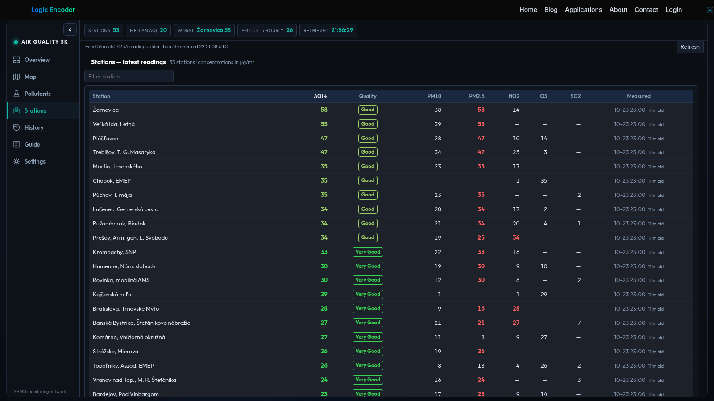
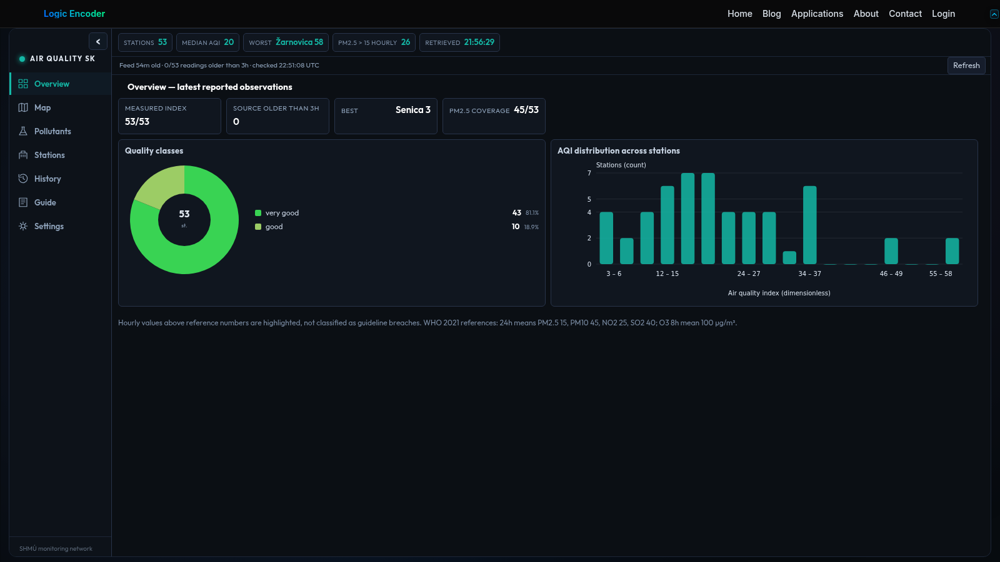

# Slovak Air Quality Dashboard

A single pollution reading is hard to interpret without knowing the station, time and surrounding history. This dashboard brings Slovakia's monitoring-station readings into a searchable board and geographic map, helping users explore where a measurement comes from and how it has changed.

## Tech stack

| Layer | Technologies |
|---|---|
| Core stack | Python; PHP; WordPress; JavaScript; SQLite |

## Start with the current picture

The overview groups available station readings with their observation times. Quality bands help users scan the information before opening a more detailed view. Sorting, filtering and paging keep a larger monitoring network manageable.

Begin with the station and observation time, then use the quality band to decide which reading needs a closer look. The list provides an entry point into the measurements rather than requiring a separate search for every station.

## Find a station on the map

A geographic map uses station locations to connect readings with place. Search the station list, select an observation or use fullscreen when examining a wider area. Station context helps avoid treating one location's reading as representative of an entire region.

The map is useful when comparing nearby stations or looking beyond a familiar location. Moving between the map and station details keeps a measurement connected to the place where it was recorded.

## Examine the pollutants

Dedicated pollutant views cover the supported particulate and gaseous measurements, including PM10, PM2.5, nitrogen dioxide, ozone and sulphur dioxide. Compact panels help compare the available readings. Units and timestamps remain part of interpreting what is being shown.

Looking at pollutants separately helps answer a more precise question than whether the air is simply good or bad. Compare the available measurements using their own units and observation times.

## Compare periods carefully

History and day comparisons help explore changes beyond the latest observation. Coverage information matters when looking at an average or comparing days with different amounts of data. Hourly readings should be understood as hourly observations rather than assumed to describe a complete day.

Use a day comparison to revisit a period of interest, then check how much information supports it. That makes a partial day distinguishable from a day with broader coverage.

## Keep the source in view

The dashboard uses published information from the Slovak national monitoring network, SHMU. A guide and presentation preferences support using the information consistently. It provides an organised view of the observations without claiming that every place or time has complete coverage.

Someone checking a familiar station can start with its latest observation; someone exploring the network can begin on the map. Both routes lead back to the same published monitoring information.

---

Private code: [air-quality-bridge](https://github.com/logicencoder/air-quality-bridge)

See [REPOS.md](REPOS.md) for related repositories.

**[Logic Encoder](https://logicencoder.com)** · [GitHub](https://github.com/logicencoder) · [Contact](https://logicencoder.com/contact/)
